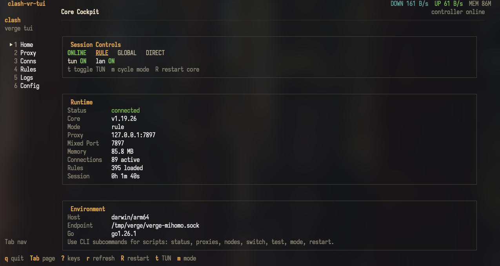
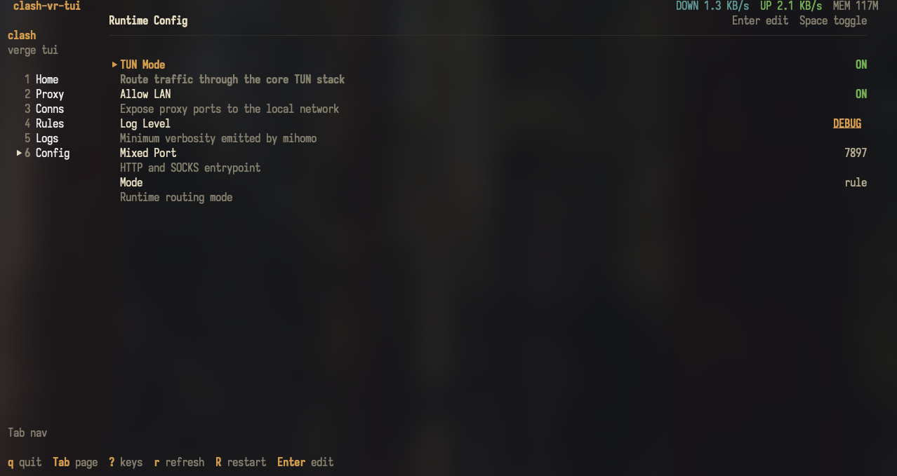

# clash-vr-tui

[](https://github.com/lr00rl/clash-vr-tui/actions/workflows/ci.yml)
[](https://github.com/lr00rl/clash-vr-tui/actions/workflows/release.yml)

A terminal UI (and CLI) for the **mihomo** core behind **Clash Verge Rev** — built
for driving your proxy from a pure terminal, including over SSH on a remote
Linux/macOS box. It talks to the mihomo controller over the Unix socket
(`/tmp/verge/verge-mihomo.sock`) or a TCP external-controller, and ships as a
single static binary with no runtime dependencies.

## Screenshots

<p>
  
</p>

<p>
  
</p>

## Quickstart

Install the latest release on Linux or macOS:

```sh
curl -fsSL https://raw.githubusercontent.com/lr00rl/clash-vr-tui/main/scripts/install.sh | sh
```

If no tagged release has been published yet, build from source:

```sh
git clone https://github.com/lr00rl/clash-vr-tui.git
cd clash-vr-tui
make build
./clash-vr-tui
```

Then run the TUI on the same machine as Clash Verge Rev / mihomo:

```sh
clash-vr-tui
```

If your mihomo controller is exposed over TCP instead of the Verge Unix socket:

```sh
clash-vr-tui --server 127.0.0.1:9090 --secret your-secret
```

For a non-interactive smoke test over SSH:

```sh
clash-vr-tui status
```

## Features

- **Home**: core status, version, mode, ports, live memory and active-connection
  count, restart the core (`R`).
- **Proxies**: two-panel groups / nodes view for 140+ node groups. In panes
  narrower than about 80 columns it shows one panel at a time: `Enter` opens the
  selected group's nodes and `Esc` or `h` returns to the group list.
  - select a node (`Enter`), color-coded delays, sort by default/name/delay (`o`)
  - every test reports each node as a delay, `timeout`, `skipped` (no known
    server, such as a sub-group), or `error`, and the header shows a count such
    as `HTTP Auto: 16/18 ok, 2 timeout`. Results are kept per test mode, so an
    HTTP delay never appears in the TCP or ICMP view.
  - **three latency test modes** cycled with `T`:
    - **HTTP**: mihomo's delay test through the tunnel (the group's own test
      URL, else the configured `test-url`)
    - **TCP**: raw connect to the node's `server:port`
    - **ICMP**: echo round-trip to the node's server
  - delay-aware filtering: `delay<200`, `delay>500`, `delay=timeout`, or a name
    substring (`/`)
  - unpin a URLTest/Fallback group back to auto (`u`)
- **Connections**: live connection table with per-connection speed, sort, filter,
  close one (`x`) / all (`X`), and a detail view (`Enter`).
- **Rules**: searchable routing rules.
- **Logs**: live `WS /logs` stream with level filter (`l`), text filter (`/`),
  freeze (`space`), and clear (`c`). Freezing stops the view, not collection;
  lines that overflow the bounded buffer are counted as dropped.
- **Config**: toggles for TUN and LAN exposure and a log level picker. Mixed
  port and mode are shown read-only here; change the mode with `m` on Home or
  `clash-vr-tui mode`.
- **Confirmation and read-back**: enabling LAN, turning TUN off, and switching to
  global or direct mode ask for `y` first. After any config change the TUI reads
  the controller back and reports whether the change actually held.
- **Stream health**: the status bar shows `LIVE` while traffic and connection
  streams are current and `STALE` with the last update time while they
  reconnect.

> **Note on TCP/ICMP:** the mihomo API does not expose node server addresses, so
> these modes parse the running mihomo config to find each `server:port`. They
> depend on the box being able to resolve the server hostname and the server
> answering — many obfuscated/CDN nodes only resolve through the tunnel, so the
> **HTTP** delay test remains the most reliable signal.

## Install

### Release installer

The installer downloads a release archive, verifies it against `checksums.txt`,
and installs to `~/.local/bin` by default. It stops without installing if the
checksum entry is missing, does not match, or neither `sha256sum` nor `shasum` is
available.

```sh
curl -fsSL https://raw.githubusercontent.com/lr00rl/clash-vr-tui/main/scripts/install.sh | sh
```

Common overrides:

```sh
BINDIR=/usr/local/bin sh -c "$(curl -fsSL https://raw.githubusercontent.com/lr00rl/clash-vr-tui/main/scripts/install.sh)"
VERSION=v0.1.0 sh -c "$(curl -fsSL https://raw.githubusercontent.com/lr00rl/clash-vr-tui/main/scripts/install.sh)"
```

### Manual download

Download the archive for your platform from
[GitHub Releases](https://github.com/lr00rl/clash-vr-tui/releases), unpack it,
and put `clash-vr-tui` on your `PATH`.

Release asset names:

| Platform | Asset |
|----------|-------|
| Linux x86_64 / amd64 | `clash-vr-tui_linux_amd64.tar.gz` |
| Linux aarch64 / arm64 | `clash-vr-tui_linux_arm64.tar.gz` |
| macOS Intel | `clash-vr-tui_darwin_amd64.tar.gz` |
| macOS Apple Silicon | `clash-vr-tui_darwin_arm64.tar.gz` |
| Windows x86_64 | `clash-vr-tui_windows_amd64.zip` |
| Windows arm64 | `clash-vr-tui_windows_arm64.zip` |

### Build from source

```sh
make build          # -> ./clash-vr-tui
make install        # -> /usr/local/bin/clash-vr-tui (PREFIX overridable)
make dist           # cross-compile release binaries into dist/
```

Requires Go 1.25+.

## Supported Platforms

| Platform | Status | Notes |
|----------|--------|-------|
| Linux amd64 / arm64 | Primary | Best fit for SSH usage. Supports Unix socket and TCP controller connections. |
| macOS amd64 / arm64 | Primary | Works with Clash Verge Rev's default Unix socket path. |
| Windows amd64 / arm64 | Secondary | Use `--server host:port`; the default Verge Unix socket path is not available. |

The TUI is designed for real terminals over SSH. It does not require a desktop
environment, and the CLI subcommands are intended for scripts and automation.

### Linux distro compatibility

The Linux release artifacts are built with `CGO_ENABLED=0`, so they are static
Go ELF binaries. Choose them by kernel OS and CPU architecture, not by distro.

| Distro / server image | Common `uname -m` | Release asset |
|-----------------------|-------------------|---------------|
| Alibaba Cloud Linux 4 / OpenAnolis | `x86_64` | `clash-vr-tui_linux_amd64.tar.gz` |
| Alibaba Cloud Linux 4 / OpenAnolis | `aarch64` | `clash-vr-tui_linux_arm64.tar.gz` |
| Amazon Linux on EC2 | `x86_64` | `clash-vr-tui_linux_amd64.tar.gz` |
| Amazon Linux on AWS Graviton | `aarch64` | `clash-vr-tui_linux_arm64.tar.gz` |
| Ubuntu / Debian | `x86_64` or `aarch64` | matching Linux asset |
| Fedora / RHEL / CentOS / Rocky / Alma | `x86_64` or `aarch64` | matching Linux asset |
| Arch Linux | `x86_64` or `aarch64` | matching Linux asset |

For this project, those distros do not need separate binaries. Differences that
usually matter for native Linux software are libc (`glibc` vs `musl`), package
format (`.deb` vs `.rpm` vs `pacman`) and system integration, but the release
binary does not dynamically link libc. The practical runtime differences are:

- CPU architecture: `x86_64` means `linux_amd64`; `aarch64`/`arm64` means
  `linux_arm64`.
- Kernel and permissions: ICMP probes may require root or `CAP_NET_RAW`;
  HTTP/TCP checks and normal controller operations do not.
- Controller access: the mihomo `external-controller` or
  `external-controller-unix` endpoint must be reachable from the terminal where
  `clash-vr-tui` runs.
- Service layout: config files may live in `/etc/mihomo/config.yaml`,
  `~/.config/mihomo/config.yaml`, or a custom `-f` path; pass `--config-path`
  when TCP/ICMP probes need help finding node server addresses.

## Usage

Launch the interactive TUI:

```sh
clash-vr-tui                          # finds the running controller
clash-vr-tui --socket /path/to.sock
clash-vr-tui --server 127.0.0.1:9090 --secret mypw   # external controller
```

### Finding the controller

With no `--socket`, `--server`, environment variable, or config-file endpoint,
`clash-vr-tui` looks for a running controller in this order and uses the first
one that answers `GET /version`:

1. running mihomo or clash processes: their `-ext-ctl-unix`, `-ext-ctl`, and
   `-ext-ctl-pipe` flags, and the config file they loaded;
2. config files: the Clash Verge Rev app directory and the usual mihomo,
   clash, and clash-meta locations (`external-controller-unix`,
   `external-controller`, `secret`);
3. known paths: `/var/run/clash-verge-service/users/<uid>/verge-mihomo.sock`
   (Clash Verge Rev service mode), `/tmp/verge/verge-mihomo.sock`, and
   `$TMPDIR/verge-mihomo.sock`; on Windows the `verge-mihomo` and `mihomo` pipes.

The process step matters for Clash Verge Rev in service mode, which passes the
socket on the command line while its generated `clash-verge.yaml` still names
an older path. `clash-vr-tui discover` prints every candidate, its state, and
which one is used:

```text
  ADDRESS                                                   KIND    STATE    VERSION   SOURCE
* /var/run/clash-verge-service/users/501/verge-mihomo.sock  socket  ok       v1.19.32  process verge-mihomo -ext-ctl-unix (+1)
  127.0.0.1:9097                                            tcp     refused  -         config ~/Library/Application Support/io.github.clash-verge-rev.clash-verge-rev/config.yaml
```

`clash-vr-tui status` shows the endpoint in use and how it was chosen.

### Plain mihomo core

`clash-vr-tui` talks to mihomo's standard REST/WebSocket controller API, so it
does not require Clash Verge Rev. For a standalone mihomo service, enable an
external controller in your mihomo config:

```yaml
external-controller: 127.0.0.1:9090
secret: "mypw"
```

Then connect with:

```sh
clash-vr-tui --server 127.0.0.1:9090 --secret mypw --config-path /etc/mihomo/config.yaml
```

`--config-path` is only needed for TCP/ICMP node probes; normal status, proxy
switching, rules, logs and connections use the controller API directly.

### Secrets and remote controllers

The controller API is plain HTTP and WebSocket, so `clash-vr-tui` refuses to send
a secret to a non-loopback TCP address. To reach a remote core, forward its
controller over SSH and connect to the local end:

```sh
ssh -N -L 9090:127.0.0.1:9090 user@router
clash-vr-tui --server 127.0.0.1:9090 --secret-file ~/.config/mihomo/secret
```

`--secret-file` (or `CLASH_VR_TUI_SECRET_FILE`, or `secret-file:` in the config
file) reads the secret from a file so it stays out of shell history and the
process list. `--secret` still works.

If you expose `external-controller-unix`, pass its socket path:

```sh
clash-vr-tui --socket /run/mihomo/mihomo.sock
```

### CLI (scriptable, no TUI)

Everything the TUI does is also a command. Data commands accept `--json`;
exit status is 0 on success, 1 on a runtime failure, and 2 on a usage error.

```sh
# find
clash-vr-tui discover                     # controllers on this machine (alias: list-socket)

# inspect
clash-vr-tui status [--json]              # version, endpoint, mode, ports, memory, conns
clash-vr-tui proxies                      # groups with their current node
clash-vr-tui nodes <group>                # nodes in a group with last delay
clash-vr-tui conns [--json]               # active connections
clash-vr-tui rules [--grep S]             # routing rules
clash-vr-tui providers                    # subscriptions (usage, expiry) and rule sets
clash-vr-tui config                       # runtime settings

# live
clash-vr-tui logs [--level L] [--grep S] [--for DUR] [--json]

# control
clash-vr-tui switch <group> <node>        # select a node
clash-vr-tui test <group> [--timeout MS]  # HTTP delay-test, sorted
clash-vr-tui unpin <group>                # URLTest/Fallback back to automatic
clash-vr-tui mode [rule|global|direct]    # get or set the proxy mode
clash-vr-tui config set tun|lan on|off    # or: config set log-level warning
clash-vr-tui providers update [name...]   # re-fetch providers (all HTTP ones by default)
clash-vr-tui close <id>... | --all | --host S
clash-vr-tui flush dns|fakeip
clash-vr-tui restart

# diagnose
clash-vr-tui doctor [--logs DUR] [--level L] [--probe] [--out DIR]   # alias: autodebug
```

`logs` streams the core's `WS /logs` until Ctrl+C or `--for` elapses and
reconnects if the core restarts. `--level` takes debug, info, warning, or
error (mihomo logs per-connection routing at debug). `--json` prints one JSON
object per line for `jq`.

`config set` reads the value back and fails if the core did not keep it, for
example when TUN cannot start without the privileges it needs.

`doctor` checks the path from controller to internet: the endpoint, runtime
settings that commonly cause trouble (direct mode, LAN exposure, debug
logging, TUN off without a system proxy), the system proxy (including a PAC URL
served on loopback, which Clash Verge Rev uses), a request through
the mixed port, DNS through the core, groups whose selected node is failing,
subscriptions near expiry or quota, connections falling through to the final
`MATCH` rule, warnings and errors in a short log capture, recent Clash Verge
Rev log errors, and other Clash clients running at the same time. Each finding
says what to do next, and the exit status is 1 when any check fails.
`--out DIR` saves the report, the captured logs, the connection snapshot, and
an allowlisted subset of the runtime config for later analysis. Credentials are
left out, subscription URLs in log lines keep only scheme and host, and profiles
are never copied. A run takes about the length of `--logs` (default 10s).

Examples:

```sh
clash-vr-tui logs --level warning --grep timeout
clash-vr-tui logs --json --for 1m | jq -r 'select(.level=="error") | .payload'
clash-vr-tui doctor --logs 30s --out ~/cvt-reports
clash-vr-tui switch for-test-ip 'JP-Tokyo-01'
clash-vr-tui status --json | jq .mode
```

## Keybindings

| Scope | Keys |
|-------|------|
| Global | `Tab`/`Shift+Tab` page · `1`–`6` jump · `?` help · `r` refresh · `R` restart core · `q`/`Ctrl+C` quit |
| Proxies | `←→`/`hl` panel · `Esc` back to groups · `j`/`k` move · `Ctrl+d`/`Ctrl+u` half-page · `g`/`G` top/bottom · `Enter` select · `d`/`D` test · `T` test mode · `o` sort · `u` unpin · `/` filter |
| Connections | `Enter` detail · `x` close · `X` close all · `s` sort · `/` filter |
| Rules | `g`/`G` top/bottom · `/` filter |
| Logs | `space` freeze · `l` level · `c` clear · `/` filter |
| Config | `Enter` edit · `Space` toggle · `j`/`k` move |

While a filter input is open, every key (including `q`) types into it; `Esc`
closes it. `Ctrl+C` always quits. The `?` help overlay scrolls with `j`/`k`,
`Ctrl+d`/`Ctrl+u`, and `g`/`G`.

## Configuration

Connection settings resolve from **flags > env > config file > auto-detect >
default path**. The
endpoint and its secret are chosen together: the first tier that names a socket
or server also supplies the secret, so a secret from the config file is never
sent to a server given on the command line.

- env: `CLASH_VR_TUI_SOCKET`, `CLASH_VR_TUI_SERVER`, `CLASH_VR_TUI_SECRET`,
  `CLASH_VR_TUI_SECRET_FILE`
- env: `CLASH_VR_TUI_CONFIG_PATH`, `CLASH_VR_TUI_TEST_URL`
- file: `config.yaml` under the OS user config directory:
  `~/.config/clash-vr-tui/` on Linux,
  `~/Library/Application Support/clash-vr-tui/` on macOS,
  `%AppData%\clash-vr-tui\` on Windows

```yaml
socket: /tmp/verge/verge-mihomo.sock   # or use an external controller:
# server: 127.0.0.1:9090
# secret-file: /etc/mihomo/controller.secret  # absolute path; or secret: "..."
config-path: ""    # explicit mihomo config path for TCP/ICMP server lookup
test-url: ""       # delay-test URL for groups without their own testUrl
```

A malformed file, an unknown key, `socket` together with `server`, or a secret
without an endpoint stops startup with the file path and the reason.

## Architecture

Go + [bubbletea](https://github.com/charmbracelet/bubbletea) (Elm architecture)
with lipgloss styling. REST + WebSocket over a Unix-socket or TCP transport.
See `docs/plans/` for the design notes.

## Release Workflow

CI runs on pushes, pull requests, and manual dispatch:

- `gofmt` check
- `go vet ./...`
- `go test ./...`
- host build
- cross-build matrix via `make dist`
- GoReleaser config validation

Tagged releases are published by GoReleaser. To cut a release:

```sh
git tag -a v0.1.0 -m "v0.1.0"
git push origin v0.1.0
```

The release workflow builds Linux, macOS, and Windows artifacts for amd64 and
arm64, uploads archives plus `checksums.txt`, and makes the installer work via
GitHub's `latest/download` URLs.

For a local release dry-run:

```sh
make release-check
make snapshot
```

These local release targets require the GoReleaser v2 CLI. GitHub Actions uses
`goreleaser/goreleaser-action`, so contributors do not need GoReleaser installed
for normal PR validation.
